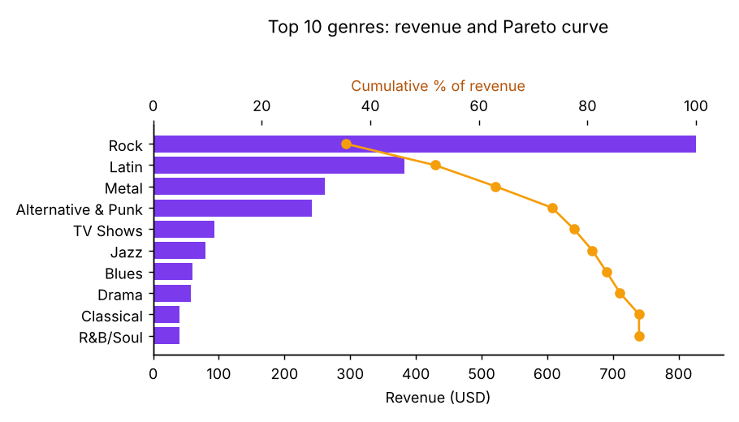
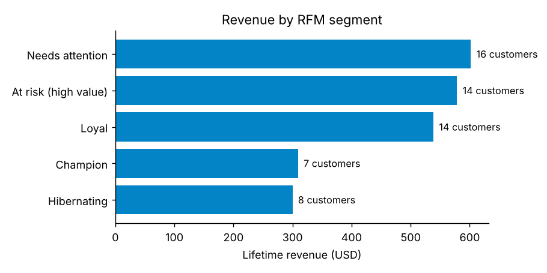

# Music Store SQL Analytics

Business questions about a digital music store, answered in **SQL**. The project covers revenue trends, market sizing, a genre Pareto analysis, **RFM customer segmentation**, **cohort retention** and sales-rep rankings. One Python script runs every query, saves the results and builds a report with charts.

  

**Data:** the [Chinook sample database](https://github.com/lerocha/chinook-database), a widely used model of an iTunes-style store (59 customers, 412 invoices, 3,500 tracks). It's a teaching dataset, so the point here is the SQL techniques rather than the absolute numbers.

👉 **Full results: [REPORT.md](REPORT.md)**

## Questions and SQL techniques

| # | Question | Techniques |
|---|---|---|
| 1 | [Monthly revenue trend and YoY growth](sql/01_monthly_revenue.sql) | CTE, `LAG(…, 12)`, rolling `AVG() OVER (ROWS BETWEEN …)` |
| 2 | [Top markets: more customers or bigger baskets?](sql/02_country_performance.sql) | aggregation, share of total with `SUM(SUM()) OVER ()` |
| 3 | [Genre revenue share and Pareto curve](sql/03_genre_share.sql) | running total with `SUM() OVER (ORDER BY …)` |
| 4 | [RFM segmentation](sql/04_rfm_segments.sql) | `NTILE(4)` scoring, `CASE` segment rules, `julianday` recency |
| 5 | [Cohort retention by first-purchase year](sql/05_cohort_retention.sql) | cohort CTE, `FIRST_VALUE() OVER (PARTITION BY …)` |
| 6 | [Support-rep performance](sql/06_sales_reps.sql) | multi-table joins, `RANK()` |
| 7 | [Best-selling artist per top market](sql/07_top_artist_by_country.sql) | five-table join, `ROW_NUMBER()` top-1-per-group |

## Key findings

- **Four genres make up ~74% of revenue** (Rock 35.5%, Latin, Metal, Alternative & Punk), a classic Pareto pattern. Catalogue and marketing effort should focus there.
- **The USA (22.5%) and Canada (13.1%) bring in over a third of revenue.** The gap comes from customer count, not basket size: revenue per customer is about $38–45 everywhere.
- **14 high-value customers are "at risk"** (good spenders who haven't bought recently). They hold about 25% of lifetime revenue, which makes them the best target for a win-back campaign.
- **Retention is strong**: on average 70–90% of each cohort buys again in later years.
- **Jane Peacock** leads the support reps on revenue managed (≈$833 across 21 customers).

<p float="left">
  
  
</p>

## Run it

```bash
pip install -r requirements.txt -r requirements-dev.txt
python analysis.py     # downloads Chinook, runs sql/*.sql → results/*.csv, figures/, REPORT.md
streamlit run app.py   # browse each question, its SQL, result and chart
pytest                 # checks that query outputs reconcile with the raw tables
```

The tests are reconciliation checks: monthly revenue must sum to total invoice revenue, genre shares must add to 100%, every customer must land in exactly one RFM segment, and each cohort must start at 100%.
