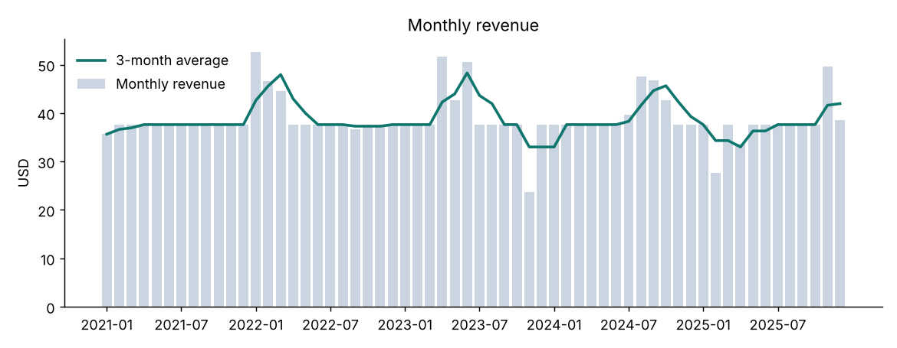
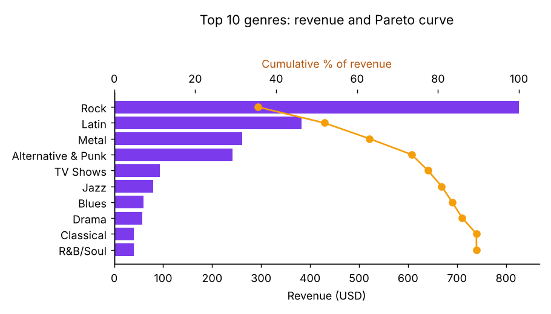
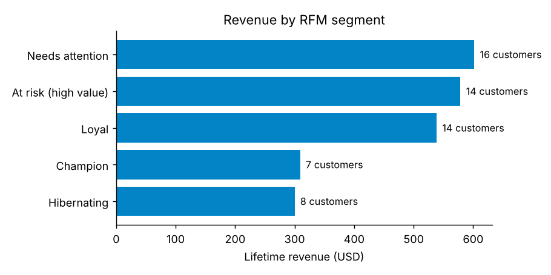
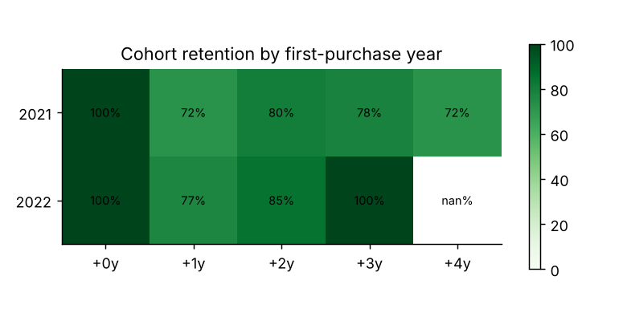

# Analysis report

*Generated by `python analysis.py`. Every table below is the output of the matching file in `sql/`.*

## Q1. How is revenue trending month by month, and how does each month compare with the same month last year?

Query: [`sql/01_monthly_revenue.sql`](sql/01_monthly_revenue.sql)

| month   |   revenue |   orders |   revenue_3mo_avg | yoy_growth_pct   |
|:--------|----------:|---------:|------------------:|:-----------------|
| 2021-01 |     35.64 |        6 |             35.64 | –                |
| 2021-02 |     37.62 |        7 |             36.63 | –                |
| 2021-03 |     37.62 |        7 |             36.96 | –                |
| 2021-04 |     37.62 |        7 |             37.62 | –                |
| 2021-05 |     37.62 |        7 |             37.62 | –                |
| 2021-06 |     37.62 |        7 |             37.62 | –                |
| 2021-07 |     37.62 |        7 |             37.62 | –                |
| 2021-08 |     37.62 |        7 |             37.62 | –                |
| 2021-09 |     37.62 |        7 |             37.62 | –                |
| 2021-10 |     37.62 |        7 |             37.62 | –                |
| 2021-11 |     37.62 |        7 |             37.62 | –                |
| 2021-12 |     37.62 |        7 |             37.62 | –                |
| 2022-01 |     52.62 |        7 |             42.62 | 47.6             |
| 2022-02 |     46.62 |        7 |             45.62 | 23.9             |
| 2022-03 |     44.62 |        7 |             47.95 | 18.6             |

*(first 15 rows)*

## Q2. Which countries bring in the most revenue, and do they have more customers or bigger baskets?

Query: [`sql/02_country_performance.sql`](sql/02_country_performance.sql)

| country        |   customers |   orders |   revenue |   revenue_per_customer |   avg_order_value |   revenue_share_pct |
|:---------------|------------:|---------:|----------:|-----------------------:|------------------:|--------------------:|
| USA            |          13 |       91 |    523.06 |                  40.24 |              5.75 |                22.5 |
| Canada         |           8 |       56 |    303.96 |                  37.99 |              5.43 |                13.1 |
| France         |           5 |       35 |    195.1  |                  39.02 |              5.57 |                 8.4 |
| Brazil         |           5 |       35 |    190.1  |                  38.02 |              5.43 |                 8.2 |
| Germany        |           4 |       28 |    156.48 |                  39.12 |              5.59 |                 6.7 |
| United Kingdom |           3 |       21 |    112.86 |                  37.62 |              5.37 |                 4.8 |
| Czech Republic |           2 |       14 |     90.24 |                  45.12 |              6.45 |                 3.9 |
| Portugal       |           2 |       14 |     77.24 |                  38.62 |              5.52 |                 3.3 |
| India          |           2 |       13 |     75.26 |                  37.63 |              5.79 |                 3.2 |
| Chile          |           1 |        7 |     46.62 |                  46.62 |              6.66 |                 2   |

## Q3. Which genres drive sales? Revenue share and cumulative share (Pareto view).

Query: [`sql/03_genre_share.sql`](sql/03_genre_share.sql)

| genre              |   revenue |   tracks_sold |   share_pct |   cumulative_pct |
|:-------------------|----------:|--------------:|------------:|-----------------:|
| Rock               |    826.65 |           835 |        35.5 |             35.5 |
| Latin              |    382.14 |           386 |        16.4 |             51.9 |
| Metal              |    261.36 |           264 |        11.2 |             63.1 |
| Alternative & Punk |    241.56 |           244 |        10.4 |             73.5 |
| TV Shows           |     93.53 |            47 |         4   |             77.5 |
| Jazz               |     79.2  |            80 |         3.4 |             80.9 |
| Blues              |     60.39 |            61 |         2.6 |             83.5 |
| Drama              |     57.71 |            29 |         2.5 |             86   |
| Classical          |     40.59 |            41 |         1.7 |             89.5 |
| R&B/Soul           |     40.59 |            41 |         1.7 |             89.5 |
| Sci Fi & Fantasy   |     39.8  |            20 |         1.7 |             91.2 |
| Reggae             |     29.7  |            30 |         1.3 |             92.5 |
| Pop                |     27.72 |            28 |         1.2 |             93.7 |
| Soundtrack         |     19.8  |            20 |         0.9 |             94.5 |
| Comedy             |     17.91 |             9 |         0.8 |             95.3 |

*(first 15 rows)*

## Q4. RFM segmentation: who are our champions, and who is slipping away?

Query: [`sql/04_rfm_segments.sql`](sql/04_rfm_segments.sql)

| customer              | country        |   recency_days |   frequency |   monetary |   r |   f |   m | segment              |
|:----------------------|:---------------|---------------:|------------:|-----------:|----:|----:|----:|:---------------------|
| Helena Holý           | Czech Republic |             39 |           7 |      49.62 |   4 |   4 |   4 | Champion             |
| Richard Cunningham    | USA            |            261 |           7 |      47.62 |   2 |   4 |   4 | At risk (high value) |
| Luis Rojas            | Chile          |            434 |           7 |      46.62 |   1 |   4 |   4 | At risk (high value) |
| Ladislav Kovács       | Hungary        |            155 |           7 |      45.62 |   3 |   4 |   4 | Champion             |
| Hugh O'Reilly         | Ireland        |             48 |           7 |      45.62 |   4 |   4 |   4 | Champion             |
| Julia Barnett         | USA            |            217 |           7 |      43.62 |   2 |   4 |   4 | At risk (high value) |
| Fynn Zimmermann       | Germany        |            202 |           7 |      43.62 |   2 |   4 |   4 | At risk (high value) |
| Frank Ralston         | USA            |            124 |           7 |      43.62 |   3 |   4 |   4 | Champion             |
| Astrid Gruber         | Austria        |            186 |           7 |      42.62 |   2 |   4 |   4 | At risk (high value) |
| Victor Stevens        | USA            |             17 |           7 |      42.62 |   4 |   4 |   4 | Champion             |
| Terhi Hämäläinen      | Finland        |              8 |           7 |      41.62 |   4 |   4 |   4 | Champion             |
| František Wichterlová | Czech Republic |            230 |           7 |      40.62 |   2 |   4 |   4 | At risk (high value) |
| Isabelle Mercier      | France         |            199 |           7 |      40.62 |   2 |   4 |   4 | At risk (high value) |
| Johannes Van der Berg | Netherlands    |            101 |           7 |      40.62 |   3 |   4 |   4 | Champion             |
| Jack Smith            | USA            |            509 |           7 |      39.62 |   1 |   3 |   3 | At risk (high value) |

*(first 15 rows)*

## Q5. Cohort retention: of customers whose first purchase was in year Y, what share bought again in each later year?

Query: [`sql/05_cohort_retention.sql`](sql/05_cohort_retention.sql)

|   cohort |   year |   years_since_first |   active_customers |   retention_pct |
|---------:|-------:|--------------------:|-------------------:|----------------:|
|     2021 |   2021 |                   0 |                 46 |           100   |
|     2021 |   2022 |                   1 |                 33 |            71.7 |
|     2021 |   2023 |                   2 |                 37 |            80.4 |
|     2021 |   2024 |                   3 |                 36 |            78.3 |
|     2021 |   2025 |                   4 |                 33 |            71.7 |
|     2022 |   2022 |                   0 |                 13 |           100   |
|     2022 |   2023 |                   1 |                 10 |            76.9 |
|     2022 |   2024 |                   2 |                 11 |            84.6 |
|     2022 |   2025 |                   3 |                 13 |           100   |

## Q6. How do support reps compare on the revenue of the customers they manage?

Query: [`sql/06_sales_reps.sql`](sql/06_sales_reps.sql)

| rep           | title               |   customers |   revenue |   revenue_per_customer |   revenue_rank |
|:--------------|:--------------------|------------:|----------:|-----------------------:|---------------:|
| Jane Peacock  | Sales Support Agent |          21 |    833.04 |                  39.67 |              1 |
| Margaret Park | Sales Support Agent |          20 |    775.4  |                  38.77 |              2 |
| Steve Johnson | Sales Support Agent |          18 |    720.16 |                  40.01 |              3 |

## Q7. What is the best-selling artist in each of the top markets?

Query: [`sql/07_top_artist_by_country.sql`](sql/07_top_artist_by_country.sql)

| country        | artist                       |   tracks_sold |
|:---------------|:-----------------------------|--------------:|
| USA            | Iron Maiden                  |            34 |
| Canada         | Os Paralamas Do Sucesso      |            16 |
| Portugal       | Iron Maiden                  |            16 |
| Germany        | Iron Maiden                  |            14 |
| Brazil         | Os Paralamas Do Sucesso      |            11 |
| France         | Creedence Clearwater Revival |            11 |
| Czech Republic | Iron Maiden                  |             9 |
| United Kingdom | Metallica                    |             9 |
